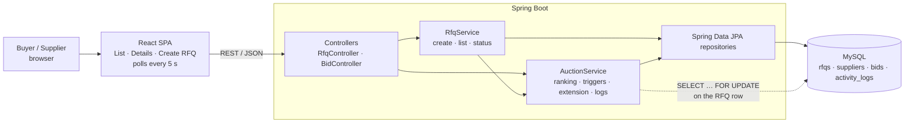
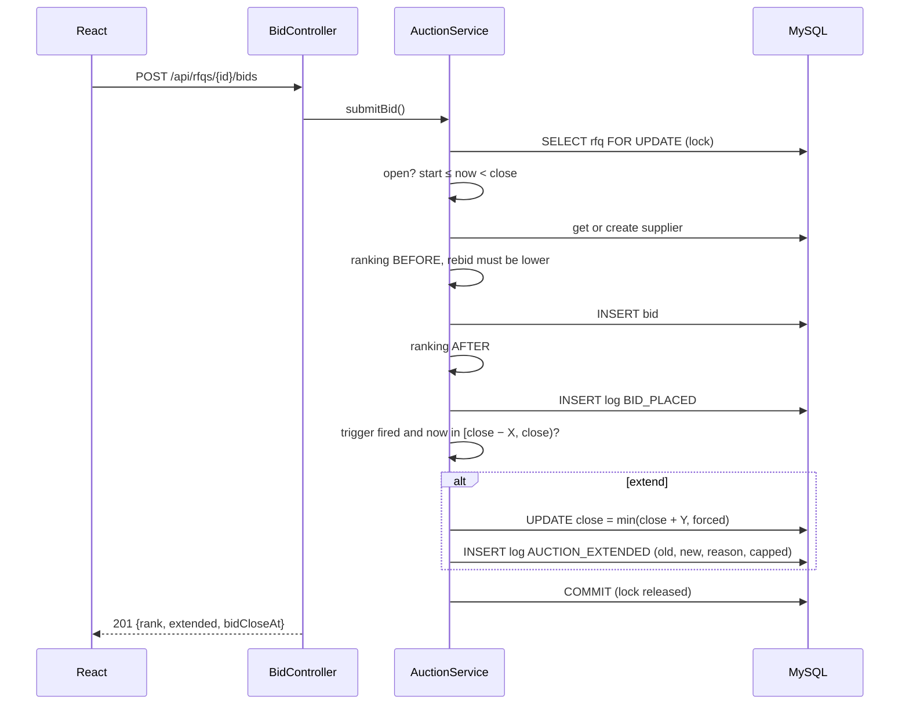
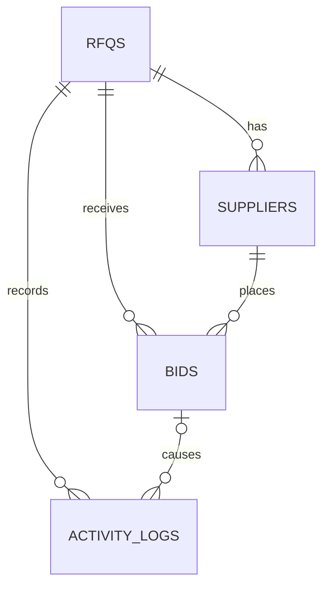

# British Auction RFQ System

A simplified RFQ (Request for Quotation) system with British Auction bidding: suppliers keep lowering their quotes, bids near the end automatically extend the auction, and nothing ever runs past the forced close time.

**Stack:** Spring Boot 4 (Java 21) · MySQL 8 · React 19 (Vite)

---

## 1. Run it

**Backend**
```bash
# MySQL: create the database once
CREATE DATABASE rfa_db;

# Set the DB password as an environment variable (never committed)
# PowerShell:  $env:DB_PASSWORD="yourpass"      bash:  export DB_PASSWORD=yourpass
cd backend/auction
./mvnw spring-boot:run          # http://localhost:8080 ; tables are created automatically
./mvnw test                     # 17 auction-rule tests on an in-memory H2 DB (no MySQL needed)
```

**Frontend**
```bash
cd frontend
npm install
npm run dev                     # http://localhost:5173
```

---

## 2. High-level design



- **Stateless API**: all state lives in MySQL, so the backend can be restarted or scaled out.
- **Status is computed on read** from the stored times and the server clock. No scheduler, so nothing can go stale.
- **Concurrency**: a bid locks its RFQ row (`PESSIMISTIC_WRITE`) for the whole transaction, so simultaneous bids are processed one at a time and each sees the latest close time.

### Bid submission flow (one transaction)



---

## 3. Schema



Full DDL: [`docs/schema.sql`](docs/schema.sql)

| Table | Purpose | Notes |
|---|---|---|
| `rfqs` | RFQ + auction config (X, Y, trigger) | `bid_close_at` moves on extension; `forced_close_at` never changes |
| `suppliers` | supplier name per RFQ | unique `(rfq_id, name)` |
| `bids` | every bid ever placed | history kept; `total` is computed, not stored, so it can't disagree with the charges |
| `activity_logs` | audit trail | bid submissions and extensions with old/new close, reason, capped flag |

| Index | Used by |
|---|---|
| `uq_rfq_supplier (rfq_id, name)` | duplicate prevention + supplier lookup on each bid |
| `idx_bid_rfq_supplier_time (rfq_id, supplier_id, created_at, id)` | loading an RFQ's bids in time order for ranking |
| `idx_log_rfq_time (rfq_id, created_at, id)` | the activity feed |

Money is `DECIMAL(12,2)` / `BigDecimal` (exact). Times are stored in UTC (`hibernate.jdbc.time_zone=UTC`) and shown in the viewer's local time.

---

## 4. API

| Method | Endpoint | Purpose |
|---|---|---|
| POST | `/api/rfqs` | create RFQ (201, or 400 with a message) |
| GET | `/api/rfqs` | listing: lowest bid, current close, forced close, status |
| GET | `/api/rfqs/{id}` | details + config + status |
| POST | `/api/rfqs/{id}/bids` | submit a quote |
| GET | `/api/rfqs/{id}/bids` | bids ranked L1, L2, … |
| GET | `/api/rfqs/{id}/activity` | activity log |

Errors are always `{"error": "..."}` with 400 or 404.

---

## 5. Auction rules

**From the specification**
1. Forced close must be later than bid close (rejected otherwise).
2. New close = `min(current close + Y, forced close)`. The auction never passes forced close.
3. The trigger window is `[current close − X, current close)`, and it moves with each extension.
4. Extensions add Y to the current close (6:00 → 6:05), not to the bid time, and can repeat until the cap.

**Trigger types** (chosen per RFQ)

| Trigger | Extends when |
|---|---|
| `BID_IN_WINDOW` | any bid is accepted inside the window |
| `ANY_RANK_CHANGE` | any already-ranked supplier changes position |
| `L1_CHANGE` | the lowest bidder (L1) changes |

**Status**

| Status | When |
|---|---|
| Upcoming | now < start |
| Active | start ≤ now < current close |
| Closed | auction ended before reaching the forced close |
| Force Closed | extensions pushed the close to the forced close, and it has passed |

---

## 6. Implementation decisions (where the spec is silent)

1. **Rebids:** a supplier may bid again, but only with a strictly lower total than their previous bid.
2. **Ranking:** each supplier's latest bid, by total = freight + origin + destination.
3. **Ties:** equal totals rank by earlier bid time, then bid id, so the order is deterministic and rewards whoever offered the price first.
4. **Bid exactly at close time:** rejected. A bid exactly at `close − X` is inside the window.
5. **`ANY_RANK_CHANGE` and newcomers:** a new supplier joining at the bottom moves nobody, so it does not extend. A newcomer entering above someone does.
6. **`L1_CHANGE` and the first bid:** the first-ever bid counts (no L1 → an L1). L1 lowering their own price does not.
7. **Already at the cap:** no further extension is logged.
8. **Time:** server clock only (an injected `Clock`, UTC). Client times are never trusted.
9. **Logging order:** the bid is logged before the extension it caused.

## 7. Scope choices

| Not built | Why / what next |
|---|---|
| Login | Auth is separate from the auction rules; a supplier is identified by name within an RFQ. Next: Spring Security + JWT with buyer/supplier roles. |
| Scheduler | Status is derived from stored times, so a restart can't leave a stale status. A delayed job would be added only to notify the buyer at close. |
| WebSockets | The UI polls every 5 s, which is enough here. At scale: WebSocket/SSE push. |

## 8. Tests

`AuctionServiceTest` runs the spec's example (close 18:00, forced 18:20, X = 10, Y = 5) through the real services and an in-memory database, using a controllable clock:

- validation: forced ≤ close, start ≥ close
- ranking, tie-break, rebid must be lower, bid before start
- trigger window edges: 17:45 (no), 17:50 (yes), at close (rejected)
- repeated extensions (18:05 → 18:10), cap at 18:20, no extension once capped, log order
- `ANY_RANK_CHANGE`: underbid extends, newcomer at bottom doesn't
- `L1_CHANGE`: new L1 extends, L1 lowering own price doesn't
- status: Closed vs Force Closed

## 9. Scaling notes

- **Bid storms:** the row lock serialises bids per RFQ; different RFQs never block each other. Higher scale: optimistic locking with retries, or a per-RFQ ordered queue.
- **Ranking:** ranks are computed from the bids table today; at scale, a Redis sorted set per RFQ gives L1 and ranks in O(log n).
- **Listing:** computes the lowest bid per RFQ on read; at scale, cache `current_lowest` on the RFQ inside the bid transaction.
- **Retries:** an idempotency key on bid submit would stop a network retry from creating a duplicate bid.
